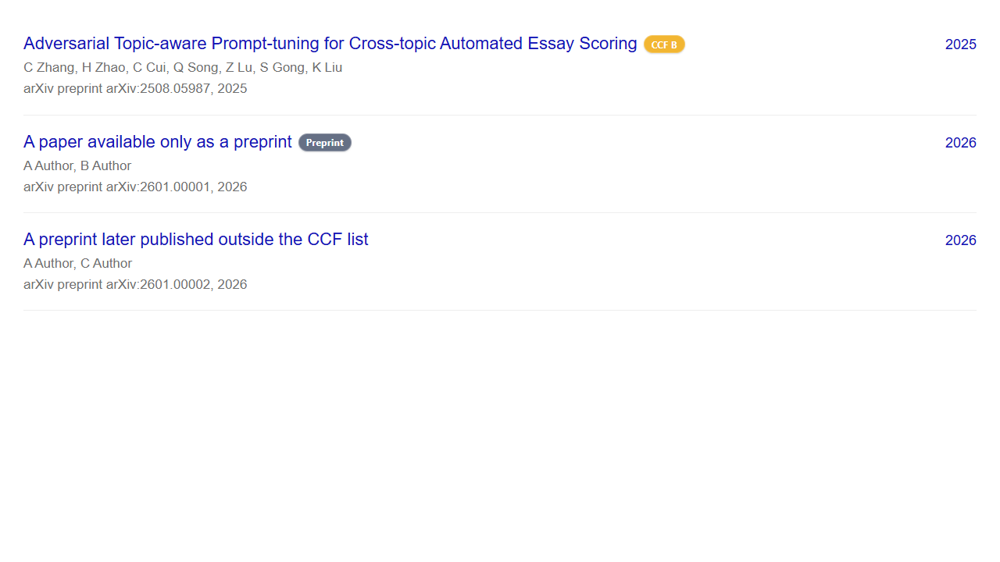

# CCF Rank PLus

[中文](README.md) · [Changelog](CHANGELOG.md) · [Privacy](PRIVACY.md) · [Contributing](CONTRIBUTING.md)

CCF Rank PLus is an open-source Chrome and Firefox extension for looking up and annotating ranks from the China Computer Federation's seventh-edition recommended international conference and journal list (2026).


Google Scholar search results and profile publication tables are annotated directly at the end of each paper title:


When Google Scholar currently lists a paper only as arXiv, the extension lazily inspects its “All versions” page. A ranked formal publication receives its CCF badge; a paper confirmed to have only preprint versions receives a neutral `Preprint` badge:



## Highlights

- 681 entries extracted from the repository's official PDF: 386 conferences and 295 journals.
- Search by abbreviation, full English name, or an explicitly documented former name.
- Filter by CCF A/B/C, venue type, and all ten CCF subject categories.
- Annotate DBLP, Google Scholar search results and profile publication tables, Semantic Scholar, Connected Papers, Web of Science, ACM DL, IEEE Xplore, and Springer Link.
- Support DBLP and its common mirrors with exact conference/journal path matching plus a metadata-text fallback.
- For a visible Google Scholar preprint, inspect “All versions” on demand: show its formal CCF rank when found, show `Preprint` if every usable version is a preprint, and show no badge for a formal venue outside the CCF list.
- Limit Scholar version checks to two concurrent same-origin requests and cache results in page memory; off-screen publications are not scanned in bulk.
- Use conservative local venue-name matching on all supported sites.
- Handle dynamically loaded results with a MutationObserver.
- Share one Manifest V3 WebExtension codebase across Chrome and Firefox.
- No server, telemetry, advertising, remote code, or persistent browsing data.

The dataset includes 95 A entries, 245 B entries, and 341 C entries. It retains documented renames such as `IR → Discover Computing`, `CASA → CASAXR`, and `FITEE → EITEE`. It also includes HotSec, the security-category continuation-row entry that is easy for table extractors to miss.

## Install

Download the browser-specific ZIP from [GitHub Releases](https://github.com/GongShuai8210/ccf-rank-extension/releases).

For Chrome, extract the Chrome ZIP, open `chrome://extensions`, enable Developer mode, and choose **Load unpacked**. For Firefox development installs, extract the Firefox ZIP, open `about:debugging#/runtime/this-firefox`, choose **Load Temporary Add-on**, and select `manifest.json`.

Stable Firefox only permits permanent installation of AMO-signed packages. The GitHub package is intended for source auditing, development, and temporary loading; the same ZIP is ready for AMO submission.

Build from source:

```bash
git clone https://github.com/GongShuai8210/ccf-rank-extension.git
cd ccf-rank-extension
npm ci
npm run check
```

Outputs are written to `dist/chrome/`, `dist/firefox/`, and `artifacts/`.

## Data maintenance

Install the extraction dependency and regenerate from the official PDF:

```bash
python -m pip install -r requirements-dev.txt
python scripts/extract_ccf_pdf.py "path/to/official-ccf.pdf" --output data/ccf-2026.json
npm run check
```

The extractor reads coordinate-bounded table cells, validates every section's row sequence, checks the expected total, and records the source PDF SHA-256. If a future PDF changes pagination, update the explicit `SECTIONS` map rather than bypassing validation. See [the maintenance notes](docs/data-maintenance.md).

## Privacy and permissions

The extension reads venue text already displayed on the academic sites named in its manifest and adds a rank badge to the current page. The CCF dataset and rank matching remain local; there is no backend, analytics, or advertising, and the extension requests no storage, tabs, or cookies permissions.

The only automatic network reads are limited Google Scholar preprint-version checks. For a visible preprint row, the extension fetches the public citation-detail and “All versions” pages from the Scholar origin already open in the tab, without browser credentials or a referrer. Nothing is sent to this project or a separate ranking service. Firefox discloses these URL requests as `browsingActivity` under Mozilla's data taxonomy; this project receives no browsing activity. See [PRIVACY.md](PRIVACY.md) for the complete boundary and ordinary network-metadata disclosure.

## Verification

```bash
npm test
npm run data:check
npm run lint:firefox
npm run check
```

The current release has been loaded in Google Chrome 151 and Firefox 154. A browser-level regression covers a supplied arXiv record that resolves through ECAI to CCF B, a true preprint, and a formal non-CCF publication. CI repeats the data, unit, Mozilla lint, build, and packaging checks for every push and pull request.

## License and disclaimer

The code is released under the [MIT License](LICENSE). The CCF directory, venue names, and trademarks remain the property of their respective owners and are not relicensed by this repository. This project is not affiliated with or endorsed by CCF. Always treat the [official CCF directory](https://www.ccf.org.cn/Academic_Evaluation/By_category/2026-03-05/861526.shtml) as authoritative. See [NOTICE.md](NOTICE.md).
