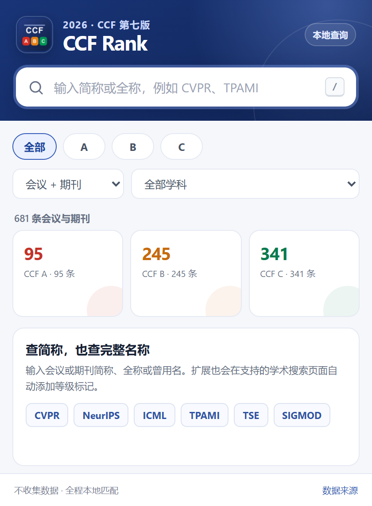
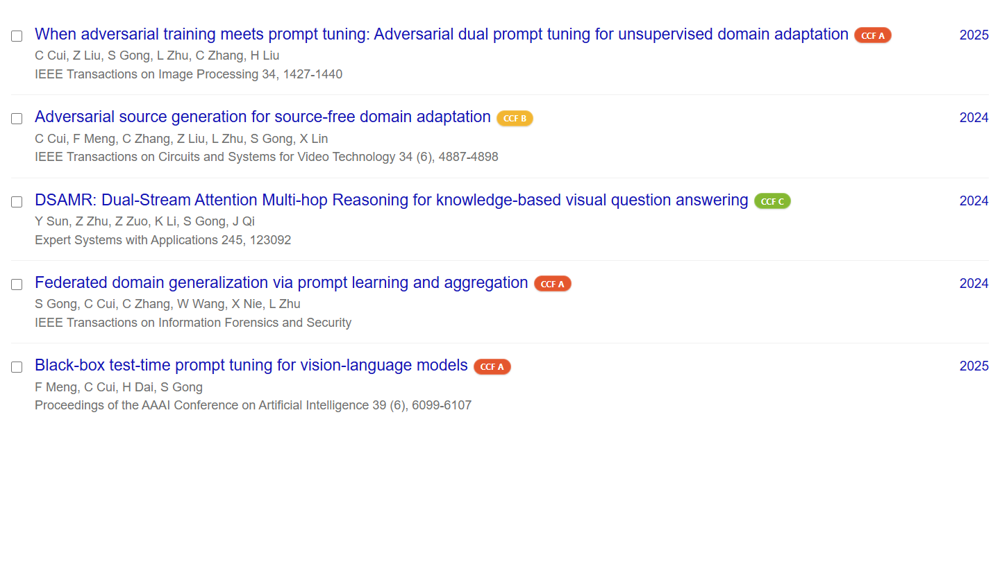

# CCF Rank 2026

[English](README.en.md) · [更新记录](CHANGELOG.md) · [隐私说明](PRIVACY.md) · [参与贡献](CONTRIBUTING.md)

一个面向 Chrome 和 Firefox 的开源浏览器扩展，用于查询并自动标注《中国计算机学会推荐国际学术会议和期刊目录（第七版，2026）》中的 CCF 等级。



Google Scholar 个人主页和搜索结果会在每篇论文标题末尾直接显示等级：



## 为什么重新实现

不少现有 CCF Rank 扩展仍使用 2019 或 2022 版数据，或者依赖远程接口。这个项目从零实现，直接以仓库中的正式版 PDF 为唯一基准生成结构化数据，并对行号、总数、分类、等级和 PDF 哈希执行自动校验。

当前数据包含：

- 681 条推荐会议/期刊；
- 386 个会议、295 种期刊；
- CCF A 类 95 条、B 类 245 条、C 类 341 条；
- 10 个 CCF 学科分类；
- 新版更名与曾用名，例如 `IR → Discover Computing`、`CASA → CASAXR`、`FITEE → EITEE`；
- 安全领域 C 类会议 `HotSec`。该条目容易被按续页表头解析的第三方数据遗漏。

## 功能

- 在工具栏弹窗中按简称、完整英文名或曾用名查询；
- 按 A/B/C、会议/期刊和学科分类筛选；
- 在学术搜索结果和 Google Scholar 个人主页论文列表中，把彩色 `CCF A/B/C` 标记直接显示在标题末尾；
- DBLP 优先使用 URL 路径精确匹配，其余站点使用本地名称索引和保守的多策略匹配；
- MutationObserver 支持无限滚动和单页应用动态加载；
- 中英文界面随浏览器语言切换；
- 不使用后台服务器、远程代码、统计分析或广告；
- Chrome 与 Firefox 共用一套 WebExtension Manifest V3 源码。

## 支持的网站

| 网站 | 自动标注 | 匹配方式 |
| --- | --- | --- |
| DBLP 及常用镜像 | 是 | DBLP 路径精确匹配，文本回退 |
| Google Scholar 搜索结果与个人主页 | 是 | 来源字段本地匹配，标签紧跟论文标题 |
| Semantic Scholar | 是 | 会议/期刊元数据本地匹配 |
| Connected Papers | 是 | 动态结果卡片本地匹配 |
| Web of Science（含中国域名） | 是 | 来源字段本地匹配 |
| ACM Digital Library | 是 | 结果元数据本地匹配 |
| IEEE Xplore | 是 | 结果元数据本地匹配 |
| Springer Link | 是 | 结果元数据本地匹配 |

学术网站会不定期调整 DOM。工具栏查询不依赖任何外部页面，因此始终可用；若某个站点未显示标记，欢迎提交 issue 并附页面类型和脱敏后的 HTML 片段。

## 安装

### 从 GitHub Release 安装开发者版本

1. 从 [Releases](https://github.com/GongShuai8210/ccf-rank-extension/releases) 下载对应浏览器的 ZIP。
2. Chrome：解压 `chrome.zip`，打开 `chrome://extensions`，启用“开发者模式”，点击“加载已解压的扩展程序”，选择解压目录。
3. Firefox：解压 `firefox.zip`，打开 `about:debugging#/runtime/this-firefox`，点击“临时载入附加组件”，选择目录中的 `manifest.json`。

Firefox 稳定版只允许永久安装经 AMO 签名的扩展；GitHub Release 中的包用于源码审计、开发和临时载入。提交 Chrome Web Store/AMO 时可以直接上传 `npm run package` 生成的对应 ZIP。

### 从源码安装

```bash
git clone https://github.com/GongShuai8210/ccf-rank-extension.git
cd ccf-rank-extension
npm ci
npm run check
```

构建目录：

- Chrome：`dist/chrome/`
- Firefox：`dist/firefox/`
- 发布包：`artifacts/ccf-rank-1.1.0-{chrome,firefox}.zip`

## 更新 CCF 数据

安装 PDF 提取依赖：

```bash
python -m pip install -r requirements-dev.txt
```

用新版正式 PDF 重新生成数据：

```bash
python scripts/extract_ccf_pdf.py "第七版中国计算机学会推荐国际学术会议和期刊目录（正式版）.pdf" \
  --output data/ccf-2026.json
npm run check
```

提取器基于表格坐标读取英文单元格，并验证每个分区的连续行号。新版 PDF 如果改变页码或版式，需要先更新 `scripts/extract_ccf_pdf.py` 中的 `SECTIONS`，而不是跳过校验。更多说明见 [数据维护说明](docs/data-maintenance.md)。

## 项目结构

```text
data/                  经过校验的结构化 CCF 数据
extension/             可直接载入的 WebExtension 源码
  content/             各学术站点的自动标注逻辑
  popup/               工具栏查询界面
  shared/              搜索与匹配引擎
scripts/               PDF 提取、校验、构建和打包
tests/                 Node.js 单元测试
docs/                  截图和数据维护文档
```

## 隐私与权限

扩展只在 manifest 明确列出的学术网站读取页面中已显示的会议/期刊文本，并在当前页面添加等级标签。匹配在本地完成，不会上传检索词、页面内容、浏览历史或任何个人信息，也不申请 `storage`、`tabs`、`cookies` 等额外权限。详见 [PRIVACY.md](PRIVACY.md)。

## 开发与验证

```bash
npm test             # 搜索、曾用名、URL 和歧义匹配测试
npm run data:check   # 数据数量、分类、哈希和字段完整性
npm run lint:firefox # Mozilla 官方 web-ext 严格校验
npm run check        # 完整校验、构建和打包
```

当前版本已在 Google Chrome 151 和 Firefox 154 上完成实际加载测试。CI 会在每次 push/PR 时执行相同校验并上传 Chrome/Firefox 构建产物。

## 许可证与声明

代码使用 [MIT License](LICENSE)。CCF 目录、会议/期刊名称及相关商标归各自权利人所有，不因代码许可证而改变。本项目与中国计算机学会没有隶属或背书关系；等级信息仅用于便捷查询，请以 [CCF 官方目录](https://www.ccf.org.cn/Academic_Evaluation/By_category/2026-03-05/861526.shtml) 为准，也不应将单一目录简单用作学术评价依据。详见 [NOTICE.md](NOTICE.md)。

## 致谢

感谢中国计算机学会公开目录。支持站点的选择参考了社区中长期使用的 CCFrank 和 show-rank 等同类工具；本仓库的 MV3 架构、数据管线、匹配引擎与界面均重新实现。
